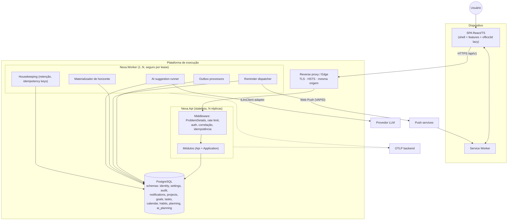
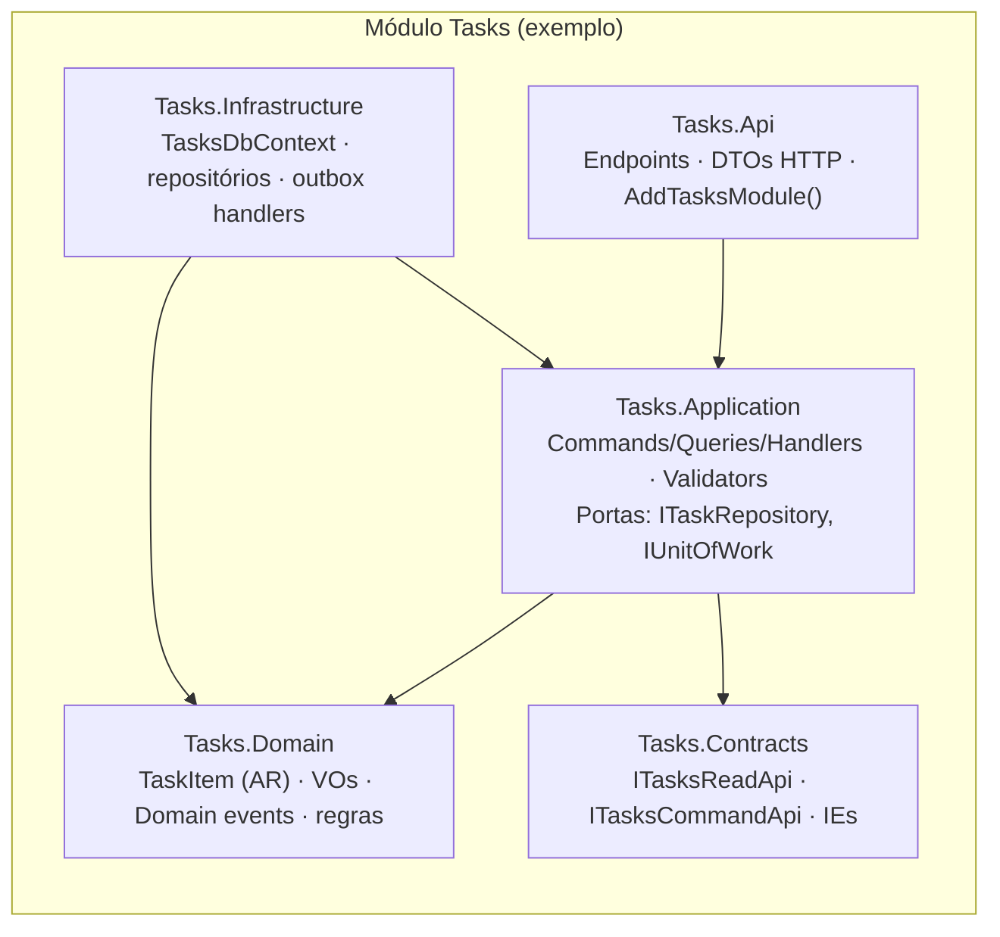
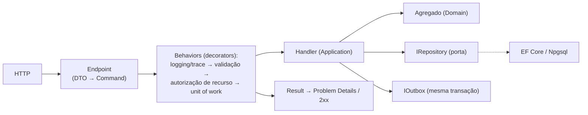
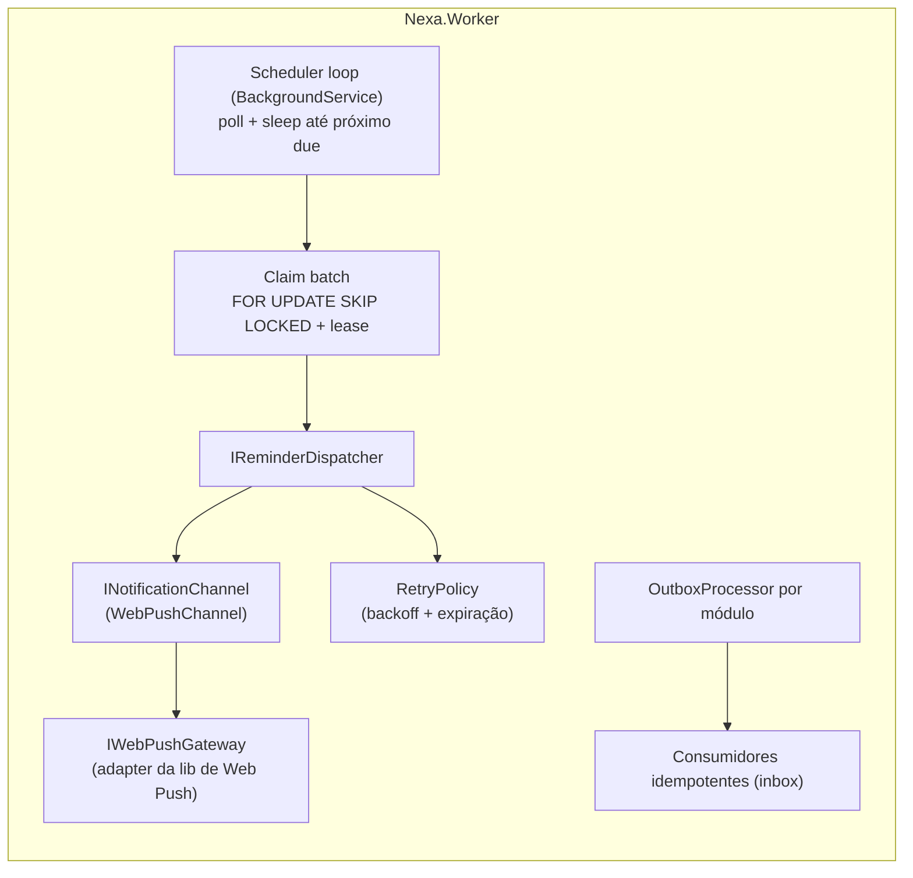
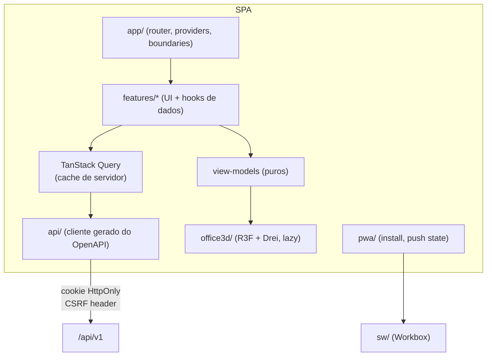

# Diagramas de Componentes

> Status: **Proposto** · Diagramas em Mermaid (renderizam no GitHub).

## 1. Contêineres e infraestrutura

## 2. Camadas dentro de um módulo

## 3. Pipeline de um caso de uso (backend)

Sem biblioteca de mediator: `ICommandHandler<TCommand,TResult>` + decorators registrados explicitamente (composição simples, depurável, sem dependência comercial).

## 4. Worker — componentes e portas

Substituição futura por fila dedicada: troca-se a implementação de `IOutboxProcessor`/`IReminderDispatcher` (ou apenas o *transporte* entre elas) sem tocar em Domain/Application.

## 5. Frontend

Regras: `office3d` **não** importa `api/` nem `features/*` — recebe view-models por props/contexto (testável sem WebGL, trocável por 2D). Features não importam umas às outras; compartilham via `shared/`.

## 6. Pontos de extensão previstos

| Ponto | Hoje | Amanhã (se a escala/produto exigir) |
|---|---|---|
| Transporte de eventos | Outbox em PG + polling | Broker/fila |
| Despacho atrasado de lembretes | Polling indexado por `due_at` | Fila com delay |
| Canais | Web Push + in-app | Outros canais atrás de `INotificationChannel` |
| LLM | Um adapter configurado | Múltiplos/roteamento por tarefa |
| Módulo → serviço | In-process | Extração de um módulo (Notifications é o candidato natural) mantendo `Contracts` |
