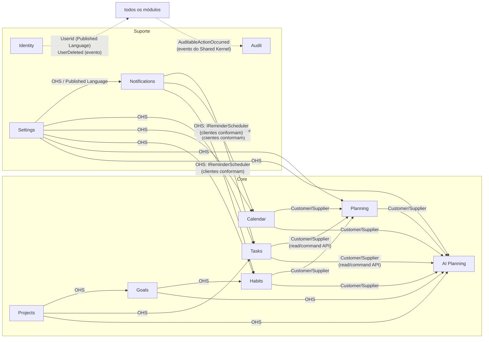

# Context Map e Modelo de Domínio Inicial

> Status: **Proposto** · Os modelos abaixo são o **ponto de partida** para os agentes de implementação. Atributos são ilustrativos; invariantes e fronteiras são normativos.

## 1. Linguagem ubíqua mínima

| Termo | Significado |
|---|---|
| **Usuário (User)** | Dono dos dados. Toda entidade de usuário pertence a exatamente um `UserId`. |
| **Tarefa (Task)** | Unidade de trabalho a fazer, com ou sem prazo. |
| **Compromisso (Event)** | Item de agenda com horário (ou dia inteiro), possivelmente recorrente. |
| **Bloco (TimeBlock)** | Intervalo de tempo reservado num plano para algo (tarefa, compromisso, hábito ou rótulo livre). |
| **Plano (DayPlan/WeekPlan)** | Intenção do usuário para um dia/semana, composta de blocos. |
| **Hábito (Habit)** | Comportamento recorrente acompanhado por check-ins. |
| **Rotina (Routine)** | Sequência/conjunto de hábitos ligados a um período do dia; inclui a rotina de sono. |
| **Lembrete (Reminder)** | Intenção persistente de avisar o usuário num instante UTC. |
| **Entrega (Delivery)** | Tentativa de entregar um lembrete por um canal a uma inscrição. |
| **Sugestão (Suggestion)** | Proposta gerada por IA, composta de mudanças propostas que exigem aprovação. |
| **Mudança proposta (ProposedChange)** | Um comando tipado, aprovável/rejeitável individualmente. |
| **Área (Area)** | Classificação ampla (ex.: Estudos, Trabalho, Pessoal). *(D-05)* |

## 2. Mapa de contextos

### Padrões de relacionamento

| Relação | Padrão DDD | Racional |
|---|---|---|
| BuildingBlocks ↔ todos | **Shared Kernel mínimo** | Só mecânica técnica e `UserId`. Sem termos de negócio. |
| Settings → consumidores | **Open Host Service + Published Language** | Contrato estável de preferências (`IUserPreferencesApi`). |
| Notifications → Tasks/Calendar/Habits | **OHS**; clientes **conformam** | Notifications publica `IReminderScheduler`/`ReminderRequested`; evita que Notifications conheça cada módulo. |
| Tasks/Calendar/Habits → Planning | **Customer/Supplier** | Planning é cliente; define o que precisa; fornecedores expõem APIs de leitura em `Contracts`. |
| AiPlanning → LLM | **Anti-Corruption Layer** | `ILlmClient` + validação de saída traduzem o mundo probabilístico/externo em `ProposedChange` tipados. |
| AiPlanning → módulos alvo | **Customer/Supplier**, escrita via `Command API` do fornecedor | IA nunca grava diretamente; usa o mesmo caminho e autorização do usuário. |
| Todos → Audit | **Conformist** ao evento genérico | Audit não conhece módulos; módulos conformam com `AuditableActionOccurred`. |
| Identity → todos | **Published Language** | Apenas `UserId` e o evento `UserDeleted` atravessam. |

## 3. Responsabilidades e limites (o que NÃO pertence a cada módulo)

| Módulo | Possui | Não possui |
|---|---|---|
| Identity | Conta, credenciais, passkeys, MFA, sessões | Preferências (Settings), papéis de negócio |
| Settings | Fuso, locale, início da semana, janelas de silêncio e de trabalho, consentimento de IA, preferências de notificação/3D | Lógica de entrega (Notifications), sono (Habits) |
| Audit | Registros append-only e consulta | Decidir o que é auditável (cada módulo decide e publica) |
| Notifications | Lembretes, entregas, inscrições push, caixa in-app, política de retry/expiração | Regras de quando criar lembretes (quem solicita decide), conteúdo de negócio |
| Projects | Projetos, Áreas *(D-05)* | Tarefas do projeto (Tasks referencia `ProjectId`) |
| Goals | Metas, marcos, progresso manual | Cálculo de progresso por tarefas *(D-06)* |
| Tasks | Tarefas, checklist, prazos, prioridade | Agendamento no tempo (Planning), lembretes (Notifications) |
| Calendar | Compromissos, recorrência, exceções, expansão em ocorrências | Detecção de conflito entre tarefas e compromissos (Planning) |
| Habits | Hábitos, check-ins, rotinas (incl. sono), sequências | Lembretes (usa Notifications.Contracts) |
| Planning | Planos diário/semanal, blocos, visão agregada "hoje/semana" | Posse de tarefas/compromissos/hábitos |
| AiPlanning | Pedidos de sugestão, sugestões, mudanças propostas, ledger de uso de IA | Fornecedor de LLM (adapter), dados de negócio dos alvos |

## 4. Modelo de domínio inicial

Notação: **AR** = aggregate root · **E** = entidade · **VO** = value object · **DE** = domain event · **IE** = integration event (em `Contracts`).
Todo AR tem `Id` (UUIDv7), `UserId`, `Version` (concorrência) e `CreatedAt/UpdatedAt`.

### 4.1 Identity
- **AR `User`**: `Email` (VO), `Status`, `Credentials` (hash de senha — hashing do ASP.NET Core Identity), `Passkeys[]` (E), `Mfa` (E), `SecurityStamp`.
- Invariantes: e-mail único; conta bloqueada após N falhas; remoção exige reautenticação.
- IE: `UserRegistered`, `UserDeleted` (dispara purga em todos os módulos).

### 4.2 Settings
- **AR `UserSettings`** (1 por usuário): `TimeZoneId` (IANA válido), `Locale`, `WeekStart`, `QuietHours` (VO: janelas em horário local), `WorkingHours` (VO), `NotificationPreferences` (VO: canais, ocultar conteúdo), `AiConsent` (VO: habilitado, escopos de dados autorizados, data do consentimento), `Office3dPreferences` (VO).
- Invariantes: fuso válido; janelas coerentes; IA só habilitada com consentimento registrado.
- IE: `UserSettingsChanged` (consumidores recalculam o que depender de fuso/silêncio).

### 4.3 Projects
- **AR `Project`**: `Name`, `Description`, `Status` (`Active|Paused|Completed|Archived`), `AreaId?`, `StartDate?`, `TargetDate?`.
- **AR `Area`** *(D-05)*: `Name`, `Color`.
- Invariantes: nome não vazio; transições de status válidas.

### 4.4 Goals
- **AR `Goal`**: `Title`, `Description`, `TargetDate?`, `Status`, `Milestones[]` (E: `Title`, `DueDate?`, `Done`), `ProgressPercent` (manual), `ProjectIds[]` (refs opacas).
- Invariantes: progresso 0–100; meta concluída não tem marco pendente (ou exige confirmação explícita).

### 4.5 Tasks
- **AR `TaskItem`**: `Title`, `Notes`, `Status` (`Open|Completed|Archived`), `Priority`, `Due` (VO: `DateOnly` **ou** `LocalDateTime + TimeZoneId`), `EstimatedDuration?`, `ProjectId?`, `Checklist[]` (E), `ReminderPolicy` (VO: lista de offsets relativos ao prazo), `CompletedAt?`.
- Invariantes: título 1–200; concluir é idempotente; reabrir limpa `CompletedAt`; prazo no passado permitido (tarefa atrasada é estado derivado, não campo).
- DE→IE: `TaskCreated`, `TaskDueChanged`, `TaskCompleted`, `TaskReopened`, `TaskDeleted` (todos com `aggregateVersion`). Ao mudar prazo/política, o handler grava `ReminderRequested`/`ReminderCancelled` no outbox **na mesma transação**.
- Contracts: `ITasksReadApi` (consultas por intervalo/projeto/status), `ITasksCommandApi` (criar/atualizar prazo — usada por AiPlanning).

### 4.6 Calendar
- **AR `CalendarEvent`**: `Title`, `Notes?`, `Location?`, `Schedule` (VO: `AllDay(Date,Date)` ou `Timed(LocalDateTime start, LocalDateTime end, TimeZoneId)`), `Recurrence?` (VO — D-04), `Exceptions[]` (E: ocorrência cancelada/alterada), `ReminderPolicy`, `Status` (`Confirmed|Cancelled`).
- Invariantes: `end ≥ start`; tz válido; exceção refere ocorrência existente na regra.
- Serviço de domínio: `OccurrenceExpander` (puro, sem I/O) — expande regra num intervalo `[from,to)` respeitando DST.
- Contracts: `ICalendarReadApi.GetOccurrences(from,to)`, `ICalendarCommandApi`.

### 4.7 Habits
- **AR `Habit`**: `Name`, `Schedule` (VO: recorrência + meta por período, ex.: 3×/semana), `Status` (`Active|Paused|Archived`), `GoalId?`, `ReminderPolicy`.
- **AR `HabitCheckIn`** (chave natural `(HabitId, LocalDate)` — única): `Status` (`Done|Skipped`), `Note?`. Check-in é `PUT` idempotente.
- **AR `Routine`**: `Name`, `Kind` (`General|Sleep`), `Steps[]` (E: referência a hábito + ordem + janela), `TimeOfDay`/janela alvo. Para `Kind=Sleep`: `TargetBedtime`, `TargetWakeTime` (horário local), duração-alvo derivada.
- **AR `SleepLog`** *(opcional, confirmar com produto)*: `Date`, `Bedtime`, `WakeTime`, `Quality?`.
- Invariantes: um check-in por hábito/dia; sequência (streak) **derivada** (nunca armazenada como verdade); rotina de sono tem 1 janela alvo coerente.

### 4.8 Planning
- **AR `DayPlan`** `(UserId, Date)` único: `Blocks[]` (E `TimeBlock`: `Start`, `End`, `Ref` (VO: `Task(id)|Event(id)|Habit(id)|Label(text)`), `Source` (`User|AiSuggestion(suggestionId)`)), `Intention?`.
- **AR `WeekPlan`** `(UserId, IsoWeek)` único: `Focus?`, `Intentions[]`, referência a `DayPlan`s por data.
- Invariantes: blocos do **mesmo plano** não se sobrepõem; `end > start`; bloco dentro do dia local do plano. Conflito com Calendar/Tasks é **aviso calculado** em consulta (não invariante — dados de outros módulos).
- Read model: `TodayOverview` / `WeekOverview` (compõe Tasks + Calendar + Habits + Plan) — alimenta a home e a cena 3D.

### 4.9 Notifications
- **AR `Reminder`**: `SourceRef` (VO: `SourceModule`, `SourceType`, `SourceId`, `Kind`, `OccurrenceAt?`), `DueAtUtc`, `ExpiresAtUtc`, `Content` (VO: snapshot de título/corpo curto + deep link), `Status` (`Pending|Leased|Dispatched|Failed|Cancelled|Missed|Expired`), `Attempts`, `LeaseUntil?`, `SourceVersion`.
- **E `Delivery`** (filho de Reminder): `Channel`, `SubscriptionId`, `Status`, `ProviderStatusCode?`, `AttemptedAt`.
- **AR `PushSubscription`**: `EndpointHash` (único), `Endpoint`, `P256dh`, `Auth` (sensíveis — protegidos em repouso), `UserAgentLabel`, `Status` (`Active|Gone`), `LastSuccessAt?`.
- **AR `InboxItem`**: `Title`, `Body`, `DeepLink`, `CreatedAt`, `ReadAt?`, `ReminderId?`.
- Invariantes: unicidade `(SourceRef, OccurrenceAt)`; transições de status condicionais; `DueAt ≤ ExpiresAt`; lembrete `Cancelled` nunca despacha.
- IE consumidos: `ReminderRequested`, `ReminderCancelled`, `UserSettingsChanged`, `UserDeleted`.
- Detalhes: [`notification-architecture.md`](notification-architecture.md).

### 4.10 AI Planning
- **AR `SuggestionRequest`**: `Scope` (`Day(date)|Week(isoWeek)`), `UserInstruction?`, `Status` (`Queued|Running|Completed|Failed`), `ContextFingerprint`, `PromptTemplateVersion`, `Usage` (tokens in/out), `ProviderId`, `ModelId`, `FailureReason?`.
- **AR `Suggestion`**: `RequestId`, `Rationale`, `ExpiresAt`, `Status` (`Proposed|PartiallyApplied|Applied|Rejected|Expired|Failed`), `Changes[]`.
- **E `ProposedChange`**: `Kind` (catálogo fechado — D-13), `Target` (ref opaca + `BaseVersion`), `Payload` (VO tipado por `Kind`), `Decision` (`Pending|Approved|Rejected`), `Outcome` (`NotApplied|Applied|Failed|Stale`), `OutcomeDetail?`.
- Invariantes: **nenhuma mudança é aplicada sem `Decision=Approved` registrado com `UserId` + timestamp**; sugestão expirada não pode ser aprovada; aprovação repetida é no-op; `Applied` só a partir de `Approved`.
- **AR `AiUsageLedger`** (por usuário/dia): contadores de requisições e tokens para limites de custo.
- Detalhes: [`ai-architecture.md`](ai-architecture.md).

### 4.11 Audit
- **AR `AuditEntry`** (append-only, sem update/delete exceto purga por retenção/remoção de usuário): `OccurredAt`, `ActorUserId`, `ActorKind` (`User|System|AiApproval`), `Module`, `Action` (código estável), `EntityRef`, `Summary` (curto, **sem conteúdo sensível**), `CorrelationId`, `TraceId`.

## 5. Eventos de integração (catálogo inicial)

| Evento | Publicado por | Consumido por |
|---|---|---|
| `ReminderRequested` / `ReminderCancelled` | Tasks, Calendar, Habits | Notifications |
| `UserSettingsChanged` | Settings | Notifications, Planning (invalidação) |
| `UserRegistered` | Identity | Settings (cria defaults) |
| `UserDeleted` | Identity | **todos** (purga) |
| `AuditableActionOccurred` | todos | Audit |
| `TaskCompleted`, `TaskDueChanged`, … | Tasks | (reservado; hoje nenhum consumidor obrigatório) |
| `SuggestionApproved`, `ChangeApplied` | AiPlanning | Audit (via `AuditableActionOccurred`) |

Regras de contrato: eventos são **imutáveis e aditivos** (novo campo opcional ok; remover/renomear exige novo tipo/versão), carregam `eventId`, `occurredAt`, `schemaVersion`, `aggregateVersion`, `userId` e **não** carregam entidades de domínio.
