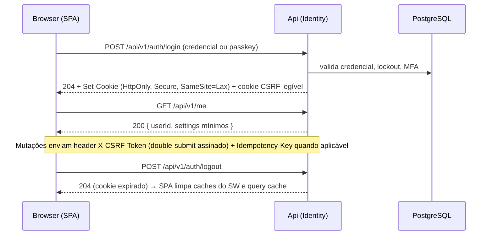
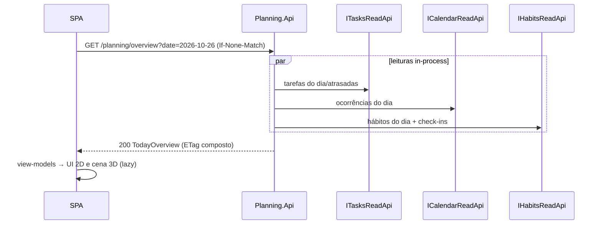

# Fluxos de Dados

> Status: **Proposto** · Sequências normativas para os fluxos que cruzam fronteiras de módulo ou de processo.

## 1. Login e sessão (PWA, mesma origem)



## 2. Criar tarefa com lembrete (consistência via outbox)

```mermaid
sequenceDiagram
  participant B as SPA
  participant T as Tasks (Api/Application)
  participant TDB as tasks.* (PG)
  participant W as Worker (OutboxProcessor)
  participant N as Notifications (Application)
  participant NDB as notifications.* (PG)
  B->>T: POST /tasks {title, due, reminders:[-30m]} + Idempotency-Key
  T->>TDB: BEGIN; INSERT task; INSERT outbox(ReminderRequested{sourceRef, dueAtUtc, content, version}); COMMIT
  T-->>B: 201 Location + ETag
  loop poll (≈1–5 s)
    W->>TDB: claim outbox msgs (SKIP LOCKED)
  end
  W->>N: deliver ReminderRequested
  N->>NDB: BEGIN; INSERT inbox(consumer,msgId) ON CONFLICT DO NOTHING; UPSERT reminder (sourceRef, occurrence) se version >= atual; COMMIT
  W->>TDB: marca outbox processada
```

Falha entre COMMIT e "marcar processada" → reentrega; a inbox torna o processamento idempotente. Se a Api cair após o COMMIT, nada se perde (outbox é durável).

## 3. Despacho de lembrete (coração da confiabilidade)

```mermaid
sequenceDiagram
  participant D as ReminderDispatcher (Worker)
  participant DB as notifications.* (PG)
  participant Ch as WebPushChannel
  participant PS as Push Service
  participant SW as Service Worker
  loop a cada ≤10 s (ou até o próximo due_at)
    D->>DB: UPDATE … SET status='Leased', lease_until=now()+60s WHERE id IN (SELECT … WHERE status='Pending' AND due_at<=now() ORDER BY due_at LIMIT n FOR UPDATE SKIP LOCKED) RETURNING *
    alt now() > due_at + MaxLateness  (ou now() > expires_at)
      D->>DB: status='Missed' + cria InboxItem (usuário vê ao abrir)
    else dentro da janela
      D->>DB: lê subscriptions ativas; checa QuietHours/preferências (Settings)
      D->>Ch: enviar (payload cifrado RFC 8291, VAPID, TTL, Topic=reminderId)
      Ch->>PS: POST endpoint
      alt 201
        D->>DB: Delivery=Sent; Reminder=Dispatched; InboxItem
      else 404/410
        D->>DB: Subscription=Gone (não retenta)
      else 429/5xx/timeout
        D->>DB: Reminder=Pending, attempts+1, due_at'=now()+backoff (se < expires_at); senão Failed
      end
    end
  end
  PS-->>SW: push event
  SW->>SW: showNotification(tag=reminderId)  (userVisibleOnly)
```

Lease expirada (Worker morreu no meio): outra instância reclama o lembrete na próxima varredura. Reinício após indisponibilidade: tudo vencido é varrido; o que passou de `MaxLateness` vira `Missed` + inbox em vez de push antigo.

## 4. Sugestão de IA com aprovação explícita

```mermaid
sequenceDiagram
  participant U as Usuário (SPA)
  participant AP as AiPlanning.Api
  participant ADB as ai_planning.* (PG)
  participant W as Worker (AI runner)
  participant CT as Contracts (Tasks/Calendar/Habits/Planning/Settings — leitura)
  participant L as ILlmClient (adapter)
  participant TG as Contracts de comando do módulo alvo
  U->>AP: POST /ai-planning/suggestion-requests {scope, instruction} + Idempotency-Key
  AP->>ADB: valida consentimento (Settings) e limites (ledger); INSERT request(Queued)
  AP-->>U: 202 Accepted + Location
  W->>ADB: claim request (SKIP LOCKED) → Running
  W->>CT: lê contexto MÍNIMO (somente o necessário ao escopo)
  W->>L: GenerateStructured(prompt v{N}, schema, limites, timeout)
  L-->>W: JSON + usage
  W->>W: valida schema → valida semântica (alvos existem, do usuário, no horizonte, catálogo permitido)
  W->>ADB: INSERT suggestion(Proposed) + changes(BaseVersion); request=Completed; ledger+=usage
  U->>AP: GET request (poll/SSE) → vê sugestão com diff legível
  U->>AP: POST /suggestions/{id}/approve {changeIds:[…]} + Idempotency-Key
  AP->>ADB: marca changes Approved (userId, ts) [transação]
  loop cada change aprovada
    AP->>TG: comando como o usuário corrente, com If-Match = BaseVersion
    alt versão confere
      TG-->>AP: ok → Outcome=Applied
    else alvo mudou
      TG-->>AP: conflito → Outcome=Stale (não aplica)
    end
  end
  AP->>ADB: status final; publica AuditableActionOccurred(AiApproval, ChangeApplied…)
  AP-->>U: 200 resultado por mudança
```

Ponto-chave: o LLM e o Worker **só leem**; a escrita ocorre exclusivamente no ramo disparado por `approve`, com a identidade do usuário.

## 5. Leitura "hoje" (home + escritório 3D)



Uma consulta composta evita *waterfall* no cliente e mantém Tasks/Calendar/Habits desconhecendo o 3D.

## 6. Cliente desatualizado / offline

- SPA com SW antigo continua falando `/api/v1`. Mudanças da API na v1 são **somente aditivas** (ver `api-contracts.md`), logo clientes antigos seguem funcionando.
- Offline (v1): shell e último estado em cache de leitura (somente telas explicitamente "cacheáveis"); mutações offline **não** são suportadas (D-07). Ao voltar online, Query refaz fetch.
- Lembretes **não** dependem do cliente estar aberto ou online: o servidor despacha; o push acorda o SW.

## 7. Remoção de usuário (exclusão de dados)

```mermaid
sequenceDiagram
  participant U as Usuário
  participant I as Identity
  participant W as Worker
  participant M as Cada módulo
  U->>I: DELETE /me (reautenticação)
  I->>I: marca conta Deleting; revoga sessões; outbox UserDeleted
  W->>M: entrega UserDeleted (idempotente)
  M->>M: apaga/anonimiza dados do usuário no próprio schema
  M-->>W: ack
  Note over I,M: Audit retém apenas registros mínimos pseudonimizados pelo prazo de retenção (D-15)
```
