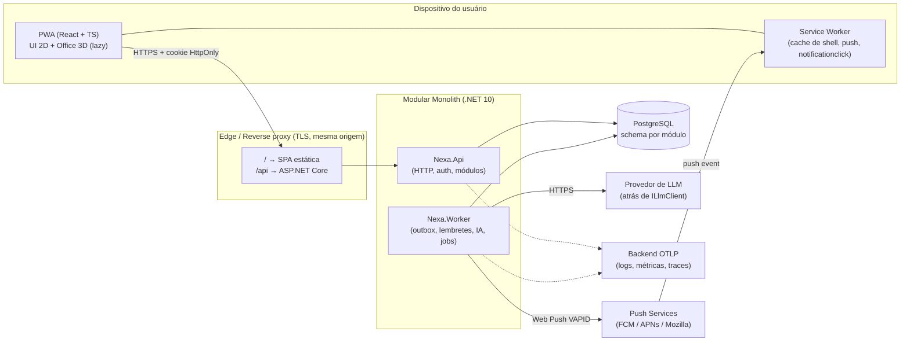
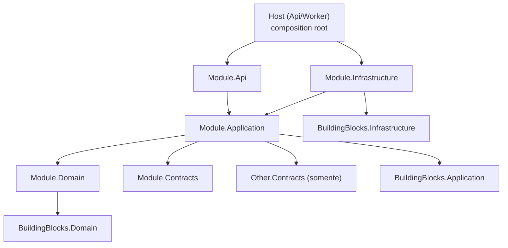
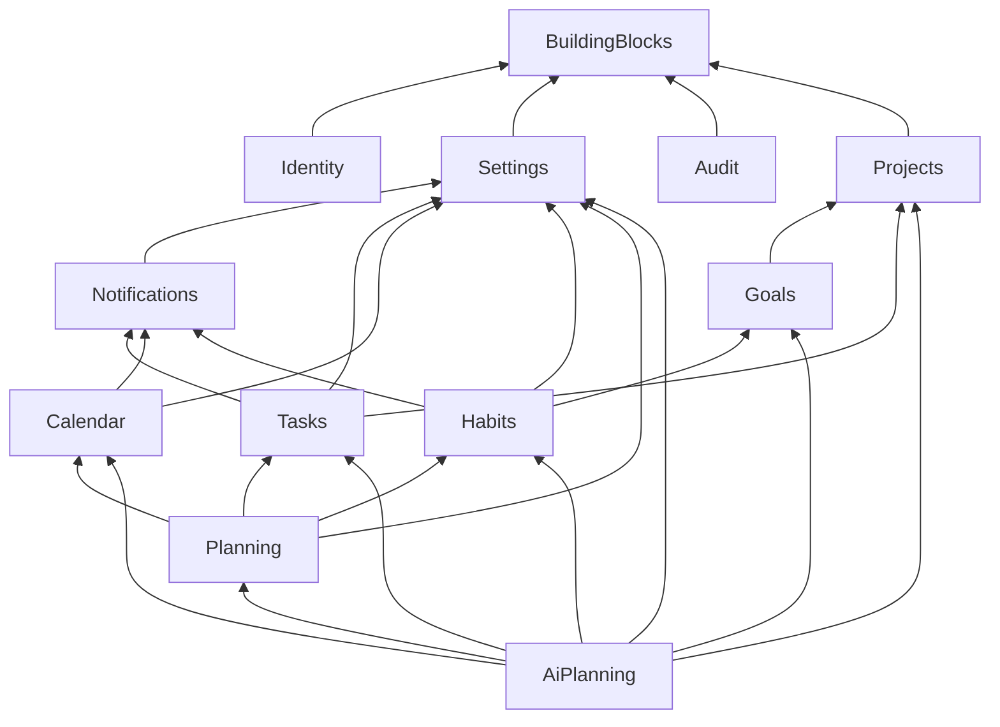

# System Overview — Nexa

> Status: **Proposto** · Data: 2026-10-26 · Autor: Software Architect
> Este documento é o ponto de entrada. Os demais documentos aprofundam partes específicas (ver [`../README.md`](../README.md)).

## 1. Propósito e escopo

Nexa é um sistema **pessoal** de produtividade, entregue como **PWA instalável** (desktop e celular), usado diariamente para tarefas, compromissos, planejamento diário/semanal, hábitos e rotinas (incluindo sono), estudos, trabalho, projetos pessoais, lembretes com push, sugestões de planejamento por IA e uma visualização 3D (escritório virtual).

Fora do escopo desta fase: implementação de funcionalidades, sincronização com calendários externos, colaboração multiusuário, aplicativos nativos. Qualquer item fora do enunciado original está marcado como **decisão pendente** em §16 — nada foi assumido como requisito.

## 2. Direcionadores de qualidade (ordem de prioridade)

1. **Confiabilidade dos lembretes** — o backend é a única fonte de verdade do agendamento.
2. **Segurança e privacidade por padrão** — dados pessoais sensíveis (rotina, sono, agenda) e envio de contexto a LLMs.
3. **Controle do usuário sobre a IA** — IA propõe, humano aprova, nada é alterado sem aprovação explícita.
4. **Simplicidade operacional** — um monolito modular, um banco, poucos processos.
5. **Evolutividade** — fronteiras de módulo reais, trocáveis (fila, LLM, canal de notificação) sem reescrever domínio.
6. **Testabilidade e observabilidade** desde o primeiro commit.

## 3. Visão de contêineres



Dois processos executam **a mesma base de código**: `Nexa.Api` (requisições) e `Nexa.Worker` (trabalho em segundo plano). Ambos são stateless; todo estado está no PostgreSQL. Por flag (`Workers:Enabled`), o Worker pode ser hospedado dentro da Api em dev/deploys mínimos; em produção recomenda-se processo separado para que deploys da Api não interrompam o despacho de lembretes.

## 4. Stack

| Camada | Escolha | Notas |
|---|---|---|
| Backend | C#, **.NET 10 (LTS)**, ASP.NET Core Minimal APIs | Sem MediatR/AutoMapper (licenças comerciais recentes) — handlers e mapeamento explícitos |
| Persistência | EF Core + Npgsql, PostgreSQL | Um `DbContext` por módulo, schema por módulo |
| Validação | FluentValidation | Na borda da Application |
| Datas/fusos | `TimeProvider` + NodaTime (IANA tz) | Obrigatório para recorrência e DST corretos |
| Background | `BackgroundService` / Generic Host | Atrás de portas substituíveis (§8.3) |
| Frontend | React, TypeScript (strict), Vite, `vite-plugin-pwa` (Workbox) | TanStack Query p/ estado de servidor |
| 3D | Three.js, React Three Fiber, Drei | Carregado sob demanda; sempre há fallback 2D |
| Observabilidade | OpenTelemetry + Serilog (JSON) | Ver [`operations.md`](operations.md) |
| IA | `ILlmClient` (provider abstraction) | Ver [`ai-architecture.md`](ai-architecture.md) |

## 5. Módulos

| Módulo | Responsabilidade | Tipo (DDD) |
|---|---|---|
| **Identity** | Contas, credenciais, passkeys/MFA, sessões | Genérico (suporte) |
| **Settings** | Preferências do usuário (fuso, silêncio, consentimento de IA, 3D) | Suporte |
| **Audit** | Trilha append-only de ações relevantes | Suporte |
| **Notifications** | Lembretes persistentes, entrega Web Push, caixa de entrada in-app | Suporte crítico |
| **Projects** | Projetos pessoais | Core (leve) |
| **Goals** | Metas e marcos | Core (leve) |
| **Tasks** | Tarefas | Core |
| **Calendar** | Compromissos e recorrência | Core |
| **Habits** | Hábitos, rotinas (inclui rotina de sono), check-ins | Core |
| **Planning** | Plano diário/semanal (blocos de tempo) e visão agregada "hoje" | Core |
| **AI Planning** | Sugestões de planejamento com aprovação explícita | Core (diferencial) |

Detalhes, agregados e relações: [`context-map.md`](context-map.md).

## 6. Estrutura da solution

```
/                               (raiz do repositório)
├─ docs/{architecture,adr}
├─ src/
│  ├─ backend/
│  │  ├─ Nexa.slnx
│  │  ├─ Directory.Build.props · Directory.Packages.props (central) · global.json · .editorconfig
│  │  ├─ Hosts/
│  │  │  ├─ Nexa.Api/                 ← composition root HTTP
│  │  │  └─ Nexa.Worker/              ← composition root de background
│  │  ├─ BuildingBlocks/               ← Shared Kernel MÍNIMO (sem conceitos de negócio)
│  │  │  ├─ Nexa.BuildingBlocks.Domain/          (Entity, AggregateRoot, ValueObject, IDomainEvent, UserId, Result)
│  │  │  ├─ Nexa.BuildingBlocks.Application/     (ICommandHandler, IQueryHandler, ICurrentUser, IUnitOfWork, IOutbox, IAuditTrail, behaviors)
│  │  │  ├─ Nexa.BuildingBlocks.Contracts/       (IIntegrationEvent, AuditableActionOccurred)
│  │  │  └─ Nexa.BuildingBlocks.Infrastructure/  (outbox/inbox, idempotência, EF helpers, OTel, Problem Details)
│  │  └─ Modules/
│  │     └─ <Module>/                  (Identity, Settings, Audit, Notifications, Projects, Goals, Tasks, Calendar, Habits, Planning, AiPlanning)
│  │        ├─ Nexa.<Module>.Contracts        ← ÚNICA superfície pública entre módulos
│  │        ├─ Nexa.<Module>.Domain
│  │        ├─ Nexa.<Module>.Application
│  │        ├─ Nexa.<Module>.Infrastructure   ← EF, adapters externos, handlers de outbox
│  │        └─ Nexa.<Module>.Api              ← endpoints HTTP + DTOs HTTP + DI do módulo
│  └─ frontend/web/                    (ver §14)
├─ tests/
│  ├─ backend/<Module>.{UnitTests,IntegrationTests} · ArchitectureTests · ApiContractTests
│  └─ e2e/                             (Playwright)
├─ deploy/                             (Dockerfiles, compose, manifests/IaC)
└─ .github/workflows/
```

Trade-off consciente: 5 projetos × 11 módulos ≈ 55 `csproj`. Em troca, as regras de dependência são **impostas pelo compilador**, não por disciplina. Mitigação: Central Package Management, `Directory.Build.props` e um `dotnet new` template de módulo. Raiz de namespace: `Nexa`.

## 7. Dependências entre camadas



Regras (verificadas por testes de arquitetura em CI — ver [`testing-strategy.md`](testing-strategy.md)):

1. `Domain` não referencia nada além de `BuildingBlocks.Domain`. Sem EF, sem ASP.NET, sem SDKs de terceiros.
2. `Application` referencia `Domain`, `Contracts` (próprio e de outros módulos) e `BuildingBlocks.Application`. **Define as portas** (repositórios, relógio, gateways); não conhece implementações.
3. `Infrastructure` implementa as portas. Nunca é referenciada por `Application`/`Domain`.
4. `Api` depende de `Application`. DTOs HTTP ≠ comandos ≠ entidades.
5. **Módulo A nunca referencia `Domain`/`Application`/`Infrastructure`/`Api` do módulo B** — só `B.Contracts`.
6. O grafo de dependências entre módulos é um **DAG** (§8.1).
7. Somente os `Hosts` referenciam `Infrastructure` (composition root); cada módulo expõe `AddXModule()` e `MapXEndpoints()`.

## 8. Comunicação entre módulos

### 8.1 Grafo de dependências (via `Contracts`)



Tudo converge para BuildingBlocks. Nenhum ciclo: `Notifications` depende só de `Settings`; módulos de negócio dependem de `Notifications.Contracts` (e não o contrário); `Projects` não conhece `Tasks` (progresso de projeto é composto na camada de leitura/UI, não por acoplamento). **Audit não depende de módulo algum**: módulos publicam `AuditableActionOccurred` (contrato do BuildingBlocks) via `IAuditTrail`.

### 8.2 Estilos de comunicação

| Necessidade | Mecanismo |
|---|---|
| Consulta síncrona cross-módulo (ex.: Planning lê tarefas do dia) | Interface de leitura em `X.Contracts` (ex.: `ITasksReadApi`), implementada em `X.Application`, resolvida in-process |
| Comando cross-módulo (ex.: AiPlanning aplica mudança aprovada) | Interface de comando em `X.Contracts` (ex.: `ITasksCommandApi`), **sempre como o usuário corrente** (mesma autorização das chamadas HTTP) |
| Fato ocorrido / efeito colateral assíncrono | **Integration event** via **transactional outbox**; consumidor idempotente via inbox |

Não há transação distribuída: cada caso de uso confirma **uma** transação em **um** módulo; o resto é consistência eventual por eventos.

### 8.3 Pontos de substituição (sem overengineering)

| Porta | Implementação inicial | Substituível por |
|---|---|---|
| `IIntegrationEventPublisher` / `IOutboxProcessor` | Outbox no PostgreSQL + `BackgroundService` | Broker/fila dedicado |
| `IReminderDispatcher` (loop de despacho) | Polling com `FOR UPDATE SKIP LOCKED` | Fila com mensagens atrasadas |
| `INotificationChannel` | `WebPushChannel` | E-mail, SMS etc. (se um dia exigido) |
| `ILlmClient` | Adapter de um provedor | Qualquer outro provedor/modelo local |
| `IClock` → `TimeProvider` | `TimeProvider.System` | `FakeTimeProvider` em testes |

## 9. Persistência

- **PostgreSQL** único; **schema por módulo** (`tasks`, `calendar`, …). **Sem FK, JOIN ou view entre schemas**; referências entre módulos são Guids opacos (`ProjectId`, `TaskId`) validados via `Contracts`. Isso permite extrair um módulo no futuro.
- **Um `DbContext` por módulo**, migrations por módulo, histórico em tabela própria por schema. Migrations aplicadas por **migration bundle** como etapa de deploy — nunca no startup em produção.
- Convenções: `snake_case`; ids **UUIDv7** gerados na aplicação (`Guid.CreateVersion7()`); `timestamptz` sempre UTC para instantes; `jsonb` apenas para payloads de evento/outbox e configurações flexíveis (nunca para dados consultáveis do domínio).
- **Instante vs. horário local**: eventos recorrentes/hábitos armazenam `LocalDateTime` + `TimeZoneId` (IANA) para sobreviver a DST; ocorrências materializadas guardam o instante UTC resultante. Datas "o dia todo" são `date`.
- **Isolamento por usuário**: toda tabela de dados de usuário tem `user_id`; entidades implementam `IUserOwned`; `DbContext` aplica *global query filter* por `ICurrentUser` + índices iniciando por `user_id`. Teste de arquitetura falha se uma entidade de usuário não implementar `IUserOwned`. (PostgreSQL RLS como defesa em profundidade: decisão pendente.)
- **Sem soft delete genérico.** Estados de negócio explícitos (`Archived`, `Cancelled`) onde o domínio pede; exclusão real para atender pedidos de remoção de dados.
- Repositórios por agregado (porta em Application, implementação em Infrastructure). Consultas de leitura podem usar projeções EF/SQL direto, sem passar pelo agregado.
- Backups e PITR do provedor + teste periódico de restauração (ver [`operations.md`](operations.md)).

Detalhes da decisão: [ADR-0002](../adr/0002-database.md).

## 10. Concorrência

| Cenário | Tratamento |
|---|---|
| Edição concorrente do mesmo agregado (dois dispositivos) | Concorrência otimista: `xmin` do PostgreSQL mapeado como row version; exposto como **ETag**; `If-Match` obrigatório em `PUT/PATCH/DELETE` → `412 Precondition Failed` com recurso atual para merge na UI |
| Várias instâncias do Worker | Claim por lote com `SELECT … FOR UPDATE SKIP LOCKED` + lease (`locked_until`, `locked_by`); transições de status condicionais (`UPDATE … WHERE status = … AND lease_token = …`); lease expirada é retomada por outra instância |
| Eventos duplicados / fora de ordem | Inbox `(consumer, message_id)` com PK; eventos carregam `aggregateVersion`; consumidores ignoram versão ≤ já aplicada (upsert por `source_ref`) |
| Duplo clique / retry de rede em POST | `Idempotency-Key` (§11) |
| Aprovação da IA × usuário editou o alvo | Cada `ProposedChange` guarda a versão-base do alvo; se divergir → `Stale`, não aplica |
| Registro simultâneo de push subscription | Índice único em `endpoint_hash` + upsert |
| Jobs periódicos "singleton" (materializar horizonte de lembretes, limpeza) | `pg_try_advisory_lock` por job **e** chaves únicas que tornam o job idempotente (`ON CONFLICT DO NOTHING`) |
| Chaves de Data Protection em múltiplas instâncias | Key ring persistido no PostgreSQL (e protegido em repouso) |

## 11. Idempotência

1. **HTTP**: `Idempotency-Key` (UUID) em `POST` que cria ou dispara efeito (criação, aprovação, check-in, pedido de sugestão). Tabela `idempotency_keys(user_id, key, request_hash, status_code, response_body, created_at, expires_at)` (retenção 24 h). Mesma chave + mesmo hash → reproduz a resposta original; mesma chave + corpo diferente → `422 idempotency_key_reuse`. Implementado como endpoint filter no BuildingBlocks. Operações naturalmente idempotentes usam `PUT` com chave natural (ex.: `PUT /habits/{id}/check-ins/{date}`).
2. **Eventos**: entrega *at-least-once*; consumidores deduplicam via inbox.
3. **Lembretes**: chave de deduplicação `(source_type, source_id, kind, occurrence_at)` — reprocessar o mesmo evento não cria lembretes duplicados.
4. **Web Push**: não existe exactly-once com push services. Mitigação: cada notificação usa `tag = reminderId` (e header `Topic`), colapsando duplicatas no dispositivo.
5. **Máquinas de estado** (aprovação de sugestão, entrega): transições repetidas para o mesmo estado são no-op bem definido.

## 12. Tratamento de erros

- **Esperado de negócio** → `Result<T>` com `Error(code, type, message)` na Application (sem exceções para fluxo). **Inesperado** → exceção, capturada por `IExceptionHandler` global.
- Respostas de erro: **RFC 9457 Problem Details** com `type`, `title`, `status`, `code` estável (`tasks.title_required`), `traceId` e, quando aplicável, `errors` por campo. Nunca vaza stack/SQL/segredos.
- Mapeamento: `400` payload/validação sintática · `401`/`403` · `404` (também usado para recurso de outro usuário — não revela existência) · `409` conflito de estado/unicidade · `412` ETag · `422` regra de domínio / idempotency reuse · `429` rate limit (`Retry-After`) · `500` genérico · `503` dependência indisponível.
- Domínio lança apenas violações de invariante programáticas (`DomainException`) — nunca exposto diretamente; handlers convertem em `Result`.
- **Falhas assíncronas** (Worker): classificação transitório × permanente; backoff exponencial com jitter; limite de tentativas; estado terminal `Failed` visível (métrica + inbox para o usuário quando relevante). Nunca falha silenciosa.
- **Dependências externas** (push service, LLM): timeout explícito, retry limitado, circuit breaker (`Microsoft.Extensions.Http.Resilience`).
- Frontend: erro tipado por `code`; *error boundary* por rota; a cena 3D tem boundary próprio e cai para a visão 2D.

## 13. Configuração por ambiente

- Ambientes: `Development`, `Staging` (opcional/pequeno), `Production`. Mesma imagem em todos; muda só configuração.
- Fontes (ordem crescente de precedência): `appsettings.json` (defaults seguros, sem segredos) → `appsettings.{Env}.json` → variáveis de ambiente → secret store da plataforma. `dotnet user-secrets` somente em dev local.
- **Options pattern** com `ValidateDataAnnotations().ValidateOnStart()`: a aplicação **não sobe** com configuração inválida/ausente.
- **Zero segredos no repositório**: connection string, chaves VAPID, chave de LLM, chaves de assinatura. CI executa `gitleaks`. `.env.example` documenta nomes, nunca valores.
- Feature flags simples via configuração (`Workers:Enabled`, `Identity:Registration:Enabled`, `Ai:Enabled`, `Ai:Provider`), sem plataforma de flags.
- Frontend: apenas configuração **pública** em build/runtime (`/config.json` servido pela Api); nada secreto no bundle.

## 14. Frontend (visão)

```
src/frontend/web/src/
  app/            shell, roteamento, providers, error boundaries
  features/       tasks/ calendar/ planning/ habits/ goals/ projects/ settings/ notifications/ ai-planning/ identity/
                  (cada feature: api hooks, components, view-models, testes)
  office3d/       cena R3F (lazy-loaded); consome apenas view-models já prontos, nunca chama a API
  pwa/            registro do SW, install prompt, estado de push
  shared/         ui kit, utils, a11y
  api/            cliente TypeScript GERADO do OpenAPI (nunca editado à mão)
  sw/             service worker (Workbox injectManifest): precache do shell, push, notificationclick
```

- Estado de servidor: TanStack Query. Estado de UI local: mínimo (React state / store pequeno). Sem cache global duplicando o servidor.
- Validação nas bordas com schemas (zod) gerados/alinhados ao OpenAPI.
- **O 3D é uma *view*, não uma fonte de verdade.** Interações na cena disparam as mesmas ações de aplicação que a UI 2D (ex.: clicar no quadro abre o plano do dia). Orçamento de desempenho, carregamento sob demanda, `prefers-reduced-motion`, fallback 2D e funcionalidade 100 % acessível sem o 3D.
- Service worker: cache de *app shell* e assets versionados; **não** cacheia respostas autenticadas da API por padrão; limpa caches e desregistra subscription local no logout. Atualização do SW com *prompt* ao usuário (evita quebrar sessão em curso). Detalhes em [ADR-0006](../adr/0006-pwa.md).

## 15. Observabilidade, segurança, testes, API, CI/CD

Cobertos em: [`operations.md`](operations.md) (observabilidade, logging, configuração, CI/CD, deploy) · [`security.md`](security.md) · [`testing-strategy.md`](testing-strategy.md) · [`api-contracts.md`](api-contracts.md) (contratos e versionamento).

## 16. Revisão arquitetural

| Verificação | Resultado |
|---|---|
| **Dependências circulares** | Nenhuma no grafo de módulos (§8.1, DAG). Pontos de risco removidos de propósito: Notifications ↛ módulos de negócio (inversão: eles chamam `Notifications.Contracts`); Audit ↛ módulos (evento genérico do BuildingBlocks); Projects ↛ Tasks. Imposto por teste de arquitetura. |
| **Dependency Inversion** | Application define portas; Infrastructure implementa; Domain sem dependências externas. LLM, relógio, push, fila, armazenamento ficam atrás de interfaces. Risco residual: `AiPlanning.Application` depende de 6 `Contracts` — aceito por ser o único orquestrador; vigiar crescimento. |
| **Acoplamento indevido** | BuildingBlocks pode virar "lixeira compartilhada": regra — sem conceito de negócio; mudanças exigem revisão. `Contracts` cresce só com o que outro módulo realmente consome. DTO HTTP ≠ comando ≠ entidade. |
| **Pontos de falha** | (1) Worker parado → lembretes atrasam: health/heartbeat + alerta de *dead-man switch* + reconciliação ao abrir o app. (2) PostgreSQL único: backup/PITR, readiness; é SPOF aceito para escala pessoal. (3) Push services/LLM indisponíveis: retry + circuit breaker + fallback in-app. (4) Entrega de push é *best-effort* fora do nosso controle — documentado como limitação, mitigado por caixa de entrada in-app. |
| **Concorrência** | Mapeada em §10; cada item tem mecanismo e teste de integração previsto. |
| **Riscos de segurança** | Prompt injection via títulos/notas; vazamento de dados a LLM (consentimento + minimização); XSS → roubo de sessão (cookie HttpOnly + CSP estrita); CSRF (SameSite + antiforgery); cache do SW em dispositivo compartilhado; segredos VAPID/LLM. Ver [`security.md`](security.md). |
| **Inconsistências entre módulos** | Sono: modelado em *Habits* (rotina) e silêncio de notificações em *Settings* — são conceitos distintos propositalmente (evita Notifications → Habits e ciclo). "Estudos/Trabalho": tratados como **Áreas** (classificação), não módulos — decisão pendente D-05. Progresso de Goals: manual no início (D-06) para não criar Goals → Tasks. |

## 17. Decisões pendentes

Ver lista numerada no relatório final e em [`../README.md`](../README.md#decisões-pendentes). Resumo: plataforma de hospedagem, primeiro provedor de LLM, modelo de recorrência (RRULE completo vs. subconjunto), escrita offline, RLS, canal de fallback além de push, single-user vs. multiusuário (registro aberto), backend OTLP, i18n.
